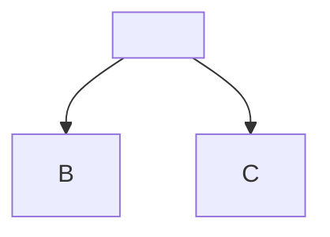

# Feature tour

A paragraph with **bold**, *emphasis*, ~~strikethrough~~, `inline <code>` and a
bare URL: https://example.com/path?q=1 plus www.example.org.

## Tables

| Left | Center | Right |
| :--- | :----: | ----: |
| a    | b      | c     |
| `x`  | **y**  | 1 < 2 |

## Task lists

- [x] done
- [ ] not yet
  - [ ] nested

## Footnotes

Here is a claim.[^1] And another.[^note]

[^1]: The first footnote.
[^note]: A named footnote.

## Alerts

> [!NOTE]
> Useful information.

> [!TIP]
> Helpful advice.

> [!IMPORTANT]
> Key information.

> [!WARNING]
> Urgent info.

> [!CAUTION]
> Risky action.

> A plain quote, not an alert.

## Code

```rust
fn main() {
    println!("<hello> & \"bye\"");
}
```

```
plain text with <tags> & 'quotes'
```

```text extra words
first word is the language
```



## Links and images

[relative markdown](other.md#section), [an anchor](#tables),
[absolute](https://example.com/), [mail](mailto:someone@example.com),
[with title](notes/two.md "Two").

 and .

## Headings: IDs & Duplicates

### Same

### Same

### `Code` in *heading*

#### Too deep for the TOC

## Raw HTML

<details>
<summary>More</summary>

Inside details.

</details>

Escapes: 5 > 3 & 2 < 4, "double" and 'single'.
